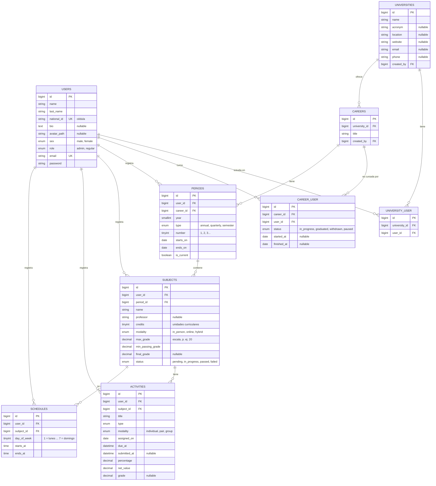

# UniTrack

> Nombre provisional. El nombre oficial del proyecto está pendiente de definir.

[](https://laravel.com)
[](https://www.php.net)
[](https://livewire.laravel.com)
[](https://filamentphp.com)
[](https://tailwindcss.com)
[](https://pestphp.com)

Plataforma web para que estudiantes universitarios gestionen su trayectoria académica: carreras, períodos, materias, evaluaciones, horarios y un calendario de actividades pendientes y entregadas.

---

## Tabla de contenidos

- [Descripción](#descripción)
- [Funcionalidades](#funcionalidades)
- [Roles y permisos](#roles-y-permisos)
- [Stack tecnológico](#stack-tecnológico)
- [Modelo de datos](#modelo-de-datos)
- [Enumeraciones](#enumeraciones)
- [Reglas de negocio](#reglas-de-negocio)
- [Arquitectura del proyecto](#arquitectura-del-proyecto)
- [Requisitos](#requisitos)
- [Instalación](#instalación)
- [Comandos útiles](#comandos-útiles)
- [Pruebas y calidad de código](#pruebas-y-calidad-de-código)
- [Desarrollo asistido por IA](#desarrollo-asistido-por-ia)
- [Decisiones pendientes](#decisiones-pendientes)
- [Hoja de ruta](#hoja-de-ruta)
- [Contribución](#contribución)
- [Licencia](#licencia)

---

## Descripción

**UniTrack** centraliza la información académica de un estudiante en una sola aplicación. Cada usuario registra las carreras que cursa, los períodos académicos de cada carrera, las materias de cada período y las evaluaciones de cada materia. A partir de esos datos, la plataforma genera:

- Un **calendario de actividades** con las evaluaciones pendientes y entregadas.
- Un **horario de clases** en vista diaria, semanal y mensual para el período en curso.

La aplicación tiene dos tipos de usuario:

| Rol | Interfaz | Propósito |
|-----|----------|-----------|
| **Regular** (estudiante) | Aplicación Livewire | Gestiona su propia información académica. |
| **Administrador** | Panel Filament (`/admin`) | Mantiene los catálogos (universidades, carreras, usuarios) y supervisa la actividad de los estudiantes. |

---

## Funcionalidades

### Usuario regular

- **Autenticación y perfil**
  - Registro e inicio de sesión con correo y contraseña.
  - Datos personales: nombre, apellido, cédula, biografía corta, foto de perfil y sexo (hombre, mujer).
- **Carreras universitarias**
  - Inscripción en una o varias carreras, de una o varias universidades.
  - Estado por carrera: en curso, graduado, retirado o pausado.
- **Períodos académicos**
  - Registro del período que cursa en cada carrera: año, trimestre o semestre.
- **Materias**
  - Nombre, profesor, unidades curriculares, modalidad (presencial, online, mixta), nota mínima aprobatoria, nota final obtenida y estado (pendiente, en curso, aprobada, reprobada).
- **Actividades y evaluaciones**
  - Título, tipo (examen, parcial, quiz, taller, exposición, informe, ensayo, debate, discusión, otro) y modalidad (individual, parejas, grupal).
  - Fecha de asignación, fecha límite de entrega y fecha real de entrega.
  - Valor porcentual, valor neto y nota obtenida.
- **Horarios**
  - Bloques de clase por materia: día, hora de inicio y hora de finalización.
- **Visualización**
  - Calendario de actividades entregadas y pendientes.
  - Horario de clases diario, semanal y mensual de cada período.

### Usuario administrador

- Gestión de usuarios.
- Gestión de universidades.
- Gestión del catálogo de carreras universitarias.
- Gestión de materias, actividades y horarios (con las restricciones de propiedad descritas en [Roles y permisos](#roles-y-permisos)).
- Consulta de los horarios de los usuarios regulares.
- Consulta del calendario de actividades de los usuarios regulares.

---

## Roles y permisos

La autorización se implementa con **Policies** de Laravel. Las Policies se aplican tanto en la aplicación Livewire como en los recursos de Filament.

### Usuario regular

| Recurso | Ver | Crear | Editar | Eliminar |
|---------|:---:|:-----:|:------:|:--------:|
| Perfil | Propio | — | Propio | Propio |
| Carreras (inscripción) | Propias | ✅ | Propias | Propias |
| Períodos | Propios | ✅ | Propios | Propios |
| Materias | Propias | ✅ | Propias | Propias |
| Actividades | Propias | ✅ | Propias | Propias |
| Horarios | Propios | ✅ | Propios | Propios |
| Calendario | Propio | — | — | — |

> El usuario regular **no tiene acceso** a los registros de otros usuarios, ni siquiera de lectura.

### Usuario administrador

| Recurso | Ver | Crear | Editar | Eliminar |
|---------|:---:|:-----:|:------:|:--------:|
| Usuarios | ✅ | ✅ | ✅ | ✅ |
| Universidades | ✅ | ✅ | ✅ | ✅ |
| Carreras (catálogo) | ✅ | ✅ | ✅ | ✅ |
| Períodos | ✅ | ✅ | Solo propios | Solo propios |
| Materias | ✅ | ✅ | Solo propias | Solo propias |
| Actividades | ✅ | ✅ | Solo propias | Solo propias |
| Horarios | ✅ | ✅ | Solo propios | Solo propios |
| Calendarios | ✅ (todos) | — | — | — |

> **Regla general de propiedad:** un registro solo puede ser modificado o eliminado por el usuario que lo creó (`user_id`). La única excepción son las universidades, las carreras del catálogo y los usuarios, que el administrador gestiona por completo.

### Ejemplo de Policy

```php
// app/Policies/SubjectPolicy.php
public function viewAny(User $user): bool
{
    return true; // El listado se filtra por usuario en la consulta.
}

public function view(User $user, Subject $subject): bool
{
    return $user->isAdmin() || $subject->user_id === $user->id;
}

public function update(User $user, Subject $subject): bool
{
    return $subject->user_id === $user->id;
}

public function delete(User $user, Subject $subject): bool
{
    return $subject->user_id === $user->id;
}
```

---

## Stack tecnológico

| Capa | Tecnología |
|------|------------|
| Lenguaje | PHP 8.3+ |
| Framework | Laravel 13 |
| Panel de administración | Filament 5 |
| Frontend reactivo | Livewire 4 + Alpine.js |
| Estilos | Tailwind CSS 4 |
| Empaquetado de assets | Vite |
| Base de datos | SQLite (desarrollo) / MySQL 8 o MariaDB (producción) |
| Pruebas | Pest |
| Estilo de código | Laravel Pint |
| Logs en tiempo real | Laravel Pail |
| Asistencia por IA | Laravel Boost (MCP, guías y skills) |
| Entorno local | Laravel Herd (Windows/macOS) o Laravel Sail (Docker) |

---

## Modelo de datos

### Diagrama entidad-relación



> Todas las tablas incluyen además las columnas `created_at` y `updated_at`.

### Relaciones

| Relación | Cardinalidad | Implementación |
|----------|--------------|----------------|
| Usuario ↔ Universidad | N:M | Tabla pivote `university_user` |
| Universidad → Carrera | 1:N | `careers.university_id` |
| Usuario ↔ Carrera | N:M | Tabla pivote `career_user` (incluye `status`) |
| Carrera → Período | 1:N | `periods.career_id` |
| Usuario → Período | 1:N | `periods.user_id` |
| Período → Materia | 1:N | `subjects.period_id` |
| Usuario → Materia | 1:N | `subjects.user_id` |
| Materia → Actividad | 1:N | `activities.subject_id` |
| Usuario → Actividad | 1:N | `activities.user_id` |
| Materia → Horario | 1:N | `schedules.subject_id` |
| Usuario → Horario | 1:N | `schedules.user_id` |

**Notas de diseño**

- El estado de una carrera (`en curso`, `graduado`, etc.) depende del estudiante, no de la carrera. Por eso se guarda en la tabla pivote `career_user` y no en `careers`.
- `user_id` se repite en `periods`, `subjects`, `activities` y `schedules`. Aunque podría deducirse a través de las relaciones, tenerlo directamente simplifica las comprobaciones de propiedad en las Policies y los filtros por usuario.
- La consistencia se valida al guardar: el `user_id` de una actividad o de un horario debe coincidir con el `user_id` de su materia.
- Las claves foráneas de los registros del estudiante usan `cascadeOnDelete()`. Al eliminar un usuario o una materia, se eliminan también sus registros dependientes.

### Relaciones Eloquent principales

```php
// app/Models/User.php
public function universities(): BelongsToMany
{
    return $this->belongsToMany(University::class)->withTimestamps();
}

public function careers(): BelongsToMany
{
    return $this->belongsToMany(Career::class)
        ->withPivot(['status', 'started_at', 'finished_at'])
        ->withTimestamps();
}

public function periods(): HasMany    { return $this->hasMany(Period::class); }
public function subjects(): HasMany   { return $this->hasMany(Subject::class); }
public function activities(): HasMany { return $this->hasMany(Activity::class); }
public function schedules(): HasMany  { return $this->hasMany(Schedule::class); }
```

---

## Enumeraciones

Los valores se almacenan en inglés (`snake_case`) y se muestran traducidos en la interfaz. Cada enum es un *backed enum* de PHP ubicado en `app/Enums` e implementa `HasLabel` de Filament.

| Enum | Valor almacenado → Etiqueta |
|------|-----------------------------|
| `Role` | `admin` → Administrador · `regular` → Estudiante |
| `Sex` | `male` → Hombre · `female` → Mujer |
| `CareerStatus` | `in_progress` → En curso · `graduated` → Graduado · `withdrawn` → Retirado · `paused` → Pausado |
| `PeriodType` | `annual` → Año · `quarterly` → Trimestre · `semester` → Semestre |
| `SubjectModality` | `in_person` → Presencial · `online` → Online · `hybrid` → Mixta |
| `SubjectStatus` | `pending` → Pendiente · `in_progress` → En curso · `passed` → Aprobada · `failed` → Reprobada |
| `ActivityType` | `exam` → Examen · `midterm` → Parcial · `quiz` → Quiz · `workshop` → Taller · `presentation` → Exposición · `report` → Informe · `essay` → Ensayo · `debate` → Debate · `discussion` → Discusión · `other` → Otro |
| `ActivityModality` | `individual` → Individual · `pair` → Parejas · `group` → Grupal |
| `DayOfWeek` | `1` → Lunes … `7` → Domingo |

```php
// app/Enums/SubjectStatus.php
enum SubjectStatus: string implements HasLabel
{
    case Pending = 'pending';
    case InProgress = 'in_progress';
    case Passed = 'passed';
    case Failed = 'failed';

    public function getLabel(): string
    {
        return match ($this) {
            self::Pending => 'Pendiente',
            self::InProgress => 'En curso',
            self::Passed => 'Aprobada',
            self::Failed => 'Reprobada',
        };
    }
}
```

---

## Reglas de negocio

### Evaluaciones

| Campo | Significado |
|-------|-------------|
| `percentage` | Peso de la actividad sobre la nota final de la materia (0–100). |
| `net_value` | Puntos máximos que aporta la actividad: `max_grade × percentage / 100`. |
| `grade` | Nota obtenida en la escala de la materia (0 – `max_grade`). |

- **Aporte de una actividad:** `grade × percentage / 100`.
- **Nota acumulada de la materia:** suma de los aportes de las actividades calificadas.
- **Validación:** la suma de los `percentage` de las actividades de una materia no puede superar 100.

### Estado de entrega

El estado de entrega no se almacena; se calcula a partir de las fechas:

| Condición | Estado |
|-----------|--------|
| `submitted_at` tiene valor | Entregada |
| `submitted_at` es nulo y `due_at` es futuro | Pendiente |
| `submitted_at` es nulo y `due_at` ya pasó | Vencida |

### Estado de la materia

- Si `final_grade ≥ min_passing_grade`, la materia puede marcarse como **aprobada**. En caso contrario, como **reprobada**.
- El estado puede actualizarse manualmente o sugerirse automáticamente al registrar la nota final.

### Horarios

- `ends_at` debe ser posterior a `starts_at`.
- Un mismo usuario no puede tener dos bloques que se solapen el mismo día dentro del mismo período.
- Las vistas diaria, semanal y mensual se generan repitiendo los bloques semanales entre `periods.starts_on` y `periods.ends_on`.

### Períodos

- Cada usuario puede tener **un único período activo** (`is_current = true`) por carrera.
- El horario y el calendario muestran por defecto el período activo.

---

## Arquitectura del proyecto

```text
app/
├── Enums/                  # Backed enums (roles, estados, tipos, modalidades)
├── Filament/
│   └── Resources/          # Recursos del panel de administración
├── Http/
│   └── Requests/           # Form Requests de validación
├── Livewire/               # Componentes de la aplicación del estudiante
│   ├── Activities/
│   ├── Calendar/
│   ├── Careers/
│   ├── Periods/
│   ├── Schedules/
│   └── Subjects/
├── Models/                 # Modelos Eloquent
├── Policies/               # Reglas de autorización por recurso
└── Providers/
database/
├── factories/
├── migrations/
└── seeders/
resources/
├── css/
├── js/
└── views/
routes/
└── web.php
tests/
├── Feature/
└── Unit/
```

**Rutas principales**

| Ruta | Descripción | Acceso |
|------|-------------|--------|
| `/` | Página de bienvenida | Público |
| `/login`, `/register` | Autenticación | Invitados |
| `/dashboard` | Resumen académico del estudiante | Autenticado |
| `/careers`, `/periods`, `/subjects`, `/activities`, `/schedules` | Gestión académica | Autenticado |
| `/calendar` | Calendario de actividades | Autenticado |
| `/admin` | Panel de administración Filament | Administrador |

---

## Requisitos

- PHP **8.3** o superior, con las extensiones `pdo_sqlite`, `pdo_mysql`, `mbstring`, `intl`, `fileinfo`, `gd` y `zip`
- Composer 2.x
- Node.js 20+ y npm
- SQLite 3 (desarrollo) o MySQL 8 / MariaDB 10.6+ (producción)
- Opcional: [Laravel Herd](https://herd.laravel.com) como entorno local

> **Windows:** si tienes varias instalaciones de PHP (WAMP, XAMPP, Laragon, Herd), comprueba con `where.exe php` que la primera ruta corresponda a la versión correcta. Una ruta antigua en el `PATH` provoca el error `Your Composer dependencies require a PHP version ">= 8.3.0"`.

---

## Instalación

### 1. Clonar el repositorio

```bash
git clone https://github.com/<usuario>/unitrack.git
cd unitrack
```

### 2. Instalar dependencias

```bash
composer install
npm install
```

### 3. Configurar el entorno

```bash
cp .env.example .env
php artisan key:generate
```

En PowerShell, usa `Copy-Item .env.example .env` en lugar de `cp`.

Variables relevantes en `.env`:

```dotenv
APP_NAME=UniTrack
APP_URL=http://unitrack.test
APP_LOCALE=es
APP_FALLBACK_LOCALE=en

DB_CONNECTION=sqlite
# Para MySQL:
# DB_CONNECTION=mysql
# DB_HOST=127.0.0.1
# DB_PORT=3306
# DB_DATABASE=unitrack
# DB_USERNAME=root
# DB_PASSWORD=

FILESYSTEM_DISK=public
```

### 4. Base de datos y almacenamiento

```bash
php artisan migrate --seed
php artisan storage:link
```

El *seeder* crea un usuario administrador para desarrollo:

| Correo | Contraseña |
|--------|------------|
| `admin@unitrack.test` | `password` |

> Cambia estas credenciales antes de desplegar en cualquier entorno accesible públicamente.

### 5. Levantar el entorno de desarrollo

```bash
composer run dev
```

Este comando inicia en paralelo el servidor, la cola de trabajos, los logs (Pail) y Vite.

Con **Laravel Herd**, el sitio queda disponible en `http://unitrack.test` sin necesidad de `php artisan serve`. En ese caso basta con ejecutar `npm run dev`.

---

## Comandos útiles

| Comando | Descripción |
|---------|-------------|
| `composer run dev` | Servidor, cola, logs y Vite en paralelo |
| `php artisan migrate:fresh --seed` | Recrea la base de datos con datos de prueba |
| `php artisan make:filament-resource Nombre --generate` | Genera un recurso de Filament a partir del modelo |
| `php artisan make:livewire Carpeta/Componente` | Crea un componente Livewire |
| `php artisan make:policy NombrePolicy --model=Nombre` | Crea una Policy asociada a un modelo |
| `php artisan test` | Ejecuta la suite de pruebas |
| `vendor/bin/pint` | Formatea el código según el estándar de Laravel |
| `npm run build` | Compila los assets para producción |

---

## Pruebas y calidad de código

El proyecto usa **Pest** para las pruebas y **Laravel Pint** para el formato.

```bash
php artisan test               # Toda la suite
php artisan test --filter=Subject
php artisan test --coverage    # Requiere Xdebug o PCOV
vendor/bin/pint --test         # Verifica el formato sin modificar archivos
```

Cobertura mínima esperada por funcionalidad:

- Las **Policies** impiden que un usuario vea, edite o elimine registros ajenos.
- Las **validaciones** de porcentajes, notas, fechas y solapamiento de horarios funcionan correctamente.
- El **panel de administración** solo es accesible para usuarios con rol `admin`.

```php
it('prevents a student from updating another student subject', function () {
    $owner = User::factory()->create();
    $intruder = User::factory()->create();
    $subject = Subject::factory()->for($owner)->create();

    expect($intruder->can('update', $subject))->toBeFalse();
});
```

---

## Desarrollo asistido por IA

El proyecto incluye **Laravel Boost**, que proporciona a los agentes de IA:

- **Guías** (`CLAUDE.md`, `AGENTS.md`) con las convenciones del stack.
- **Skills** específicas para los paquetes instalados.
- Un **servidor MCP** (`php artisan boost:mcp`) que permite consultar el esquema de la base de datos, los logs y la documentación de la versión instalada.

```bash
php artisan boost:install   # Configurar o añadir agentes
php artisan boost:update    # Actualizar guías y skills
```

Las guías propias del proyecto se añaden en `.ai/guidelines/`.

---

## Decisiones pendientes

- [ ] **Nombre oficial** del proyecto.
- [ ] **Catálogo de períodos:** ¿los crea cada estudiante, o el administrador publica un calendario académico por universidad y el estudiante lo selecciona?
- [ ] **Carreras:** ¿el estudiante solo puede elegir carreras del catálogo, o también puede proponer carreras nuevas para que el administrador las apruebe?
- [ ] **Escala de notas:** ¿se define por materia (`max_grade`) o por universidad?
- [ ] **Opciones de sexo:** confirmar si se mantienen solo las opciones actuales (hombre, mujer).

---

## Hoja de ruta

- [ ] Migraciones, modelos, enums y factories
- [ ] Autenticación y perfil del estudiante
- [ ] Panel Filament: usuarios, universidades y carreras
- [ ] Gestión de carreras, períodos y materias
- [ ] Gestión de actividades y evaluaciones
- [ ] Gestión de horarios con validación de solapamientos
- [ ] Calendario de actividades
- [ ] Vistas de horario diaria, semanal y mensual
- [ ] Vistas de supervisión para el administrador
- [ ] Notificaciones de entregas próximas (opcional)
- [ ] Reportes y estadísticas académicas (opcional)

---

## Contribución

1. Crea una rama a partir de `main`:
   ```bash
   git checkout -b feature/nombre-de-la-funcionalidad
   ```
2. Sigue el formato de [Conventional Commits](https://www.conventionalcommits.org/es/v1.0.0/):
   ```text
   feat: agregar gestión de horarios
   fix: corregir validación de porcentajes
   docs: actualizar instrucciones de instalación
   ```
3. Antes de abrir el *pull request*, ejecuta:
   ```bash
   vendor/bin/pint
   php artisan test
   ```
4. Abre un *pull request* describiendo los cambios y cómo probarlos.

---

## Licencia

Licencia pendiente de definir. Hasta entonces, todos los derechos están reservados por el autor.
